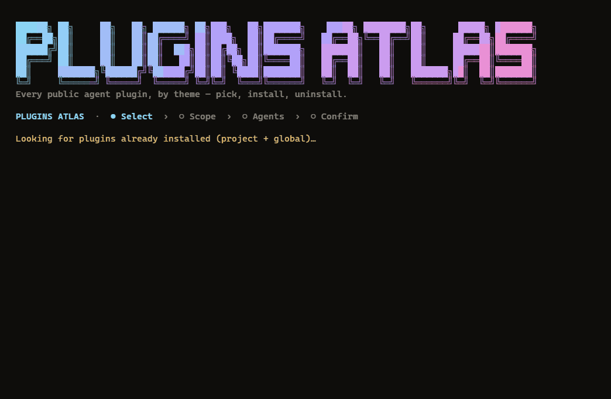

<h1 align="center"></h1>

<p align="center">Browse every public agent plugin by theme, then install it into Claude Code, Claude Desktop, Copilot CLI, Factory Droid, Codex and Cursor.</p>



*A session: search, tick, preview with `p`, choose scope and agents, then the review and its audit. Recorded with `npm run gif:frames && npm run gif`.*

Browse a catalog of public agent plugins and install them into the agents that can read them. A plugin is a declarative bundle (skills, commands, subagents, hooks, MCP servers) published in a marketplace. This is the plugins counterpart of [skills-atlas](https://github.com/devohmycode/skills-atlas) and [mcp-atlas](https://github.com/devohmycode/mcp-atlas).

## Install

Node.js 20 or newer.

```bash
npm install
npm run build
node dist/cli.js --help
```

The package binary is `plugins-atlas`.

## Usage

```bash
plugins-atlas                                  # interactive: tree → scope → agents → review, then back to the tree
plugins-atlas browse -t code-quality -q review # tree pre-filtered by theme and text
plugins-atlas browse -a claude-code cursor -g  # options given as flags are not asked
plugins-atlas install code-review@claude-plugins-official   # in a terminal: scope, agents and review, no tree
plugins-atlas install code-review@claude-plugins-official -a claude-code -y   # no question asked
```

### Keys of the tree

| Key | Action |
|---|---|
| `↑` `↓` `PgUp` `PgDn` | move |
| `→` `←` | open or close a theme |
| `space` | tick a plugin, or a whole theme; unticking an installed plugin uninstalls it |
| `/` | search; `esc` clears it |
| `a` | open or close every theme |
| `s` | sort: official first, or by name |
| `o` | official plugins only |
| `p` | read the components, the risks and the README |
| `g` | open the repository |
| `u` / `U` | mark an outdated plugin, or all of them, for update |
| `enter` | next: scope, agents, review |
| `q` | quit |

Installed plugins come first, under *Already installed*, ticked. On the review, a plugin that fails the audit is left out; `space` keeps it anyway. A plugin whose components are unknown is read and audited when it is installed.

The mouse works too: wheel to scroll, click to tick, click the hints. The wizard then runs on the alternate screen; `--no-mouse` keeps the normal screen.

### Options of the tree

| Flag | Meaning |
|---|---|
| `-t, --theme <ids...>` | only these themes |
| `-q, --search <text>` | start with this search |
| `--official` | only official plugins |
| `-s, --sort <order>` | `official` (default) or `name`; also for `list` |
| `-a, --agent <ids...>` | agents to install into; `*` is every agent of the scope |
| `-g, --global` / `-p, --project` | user profile, or this directory |
| `-y, --yes` | ask nothing: detected agents, user scope |
| `--dry-run` | print each command and file, change nothing |
| `--no-audit` | install even when a high risk is found |
| `--no-mouse` | keyboard only |

What the flags leave open is asked, pre-filled with the user scope and the detected agents. `install <ids>` takes the same `-a`, `-g`, `-p`, `--no-audit` and `--no-mouse`.

## Commands

`themes`, `list` (`-q, --search`, `-t`, `-a`, `--official`, `-s`, `-n`, `--json`), `agents`, `show` (components, risks on stderr, `--json`), `install` (`-a`, `-g` or `-p`, `-y`, `--dry-run`, `--no-audit`), `uninstall`, `installed`, `outdated`, `update`, `export`, `import`, `completion`, `browse`, `ui`, and `mcp`.

Without `-y`, `install`, `update` and `import` print the plan and change nothing. `install -y` without `-a` fails. `--dry-run` prints each command or file and changes nothing. `--offline` uses the cached or bundled snapshot and does not contact the network. `--refresh` checks for a newer snapshot now; otherwise a check waits 12 hours.

`browse`, the default command, is the terminal wizard above. In a terminal, `install <ids>` without `-y` opens it on those plugins, the tree skipped. `ui` is the local page. Both show a review before anything changes. `mcp` speaks MCP on stdio and runs no plugin component.

## Agents

| Agent | Level | Install |
| --- | --- | --- |
| Claude Code | 1 | `claude plugin …`, user and project scopes |
| Claude Desktop / Cowork | 1 | none outside the app: the steps in the app are printed |
| GitHub Copilot CLI | 1 | `copilot plugin …` (user), `.github/copilot/settings.json` (project) |
| Factory Droid | 1 | `droid plugin …`, user and project scopes |
| Codex CLI and Codex desktop | 2 | `codex plugin …` (user), `.codex/config.toml` (project); both share one install |
| Cursor | 2 | a plugin folder in `~/.cursor/plugins/local/`, user scope |

A plugin installs only into the agents that read one of its manifests. Formats are not converted. Every path, command and file comes from [docs/agents.md](docs/agents.md), written from each vendor's documentation.

## Catalog

The snapshot is built from the official marketplaces of Anthropic, OpenAI (Codex) and Cursor, from GitHub code search for `.claude-plugin/marketplace.json` (with `GITHUB_TOKEN`), and from claude-plugins.dev. `npm run crawl` rebuilds `data/catalog.json.gz`.

Each plugin's files are read one by one from GitHub to list its components; nothing is cloned and nothing is run. Without a token only 40 repositories are read (`PLUGINS_ATLAS_REPO_LIMIT` changes it); a plugin left unread is read when it is shown or installed.

## Audit

A high risk blocks install unless `--no-audit` is set, or `audit: false` in `~/.config/plugins-atlas/config.json`. High: a hook or MCP server that pipes a download into a shell (`curl | sh`), runs `npx -y` or `uvx` without an exact version (a dist-tag such as `@latest`, `*` or a range such as `@^1` or `==1.*` pins nothing), reads `~/.ssh` or `~/.aws`, or names in its command a host that is neither the repository nor a known registry. Medium: every command hook, a remote MCP server on such a host, a source pinned by neither `ref` nor `sha`, a credential-like variable name. A plugin whose files could not be read is unaudited, not failed, and is not installed.

## Related projects

The same tree, flags and review for the other kinds of agent extensions:

- [skills-atlas](https://github.com/devohmycode/skills-atlas): Agent Skills (`SKILL.md`), installed through `npx skills add`.
- [mcp-atlas](https://github.com/devohmycode/mcp-atlas): MCP servers, written into the config of Claude Code, Claude Desktop, Cursor, Codex and Grok.

## License

MIT.
